 
 
 
 
 
<!-- START_LATEST_PRS -->
<table>
<tr><th>Repository</th><th>Merged pull request</th><th>Date</th></tr>
<tr><td><a href="https://github.com/motdotla/dotenv">motdotla/dotenv</a></td><td><a href="https://github.com/motdotla/dotenv/pull/1070">fix: ignore undefined options in config so DOTENV_* env settings still apply</a> (#1070)</td><td>07 Oct 2026</td></tr>
<tr><td><a href="https://github.com/DavidHDev/vue-bits">DavidHDev/vue-bits</a></td><td><a href="https://github.com/DavidHDev/vue-bits/pull/183">Feature: add 6 new UI components, demos, and registry configs</a> (#183)</td><td>24 Sep 2026</td></tr>
<tr><td><a href="https://github.com/DavidHDev/vue-bits">DavidHDev/vue-bits</a></td><td><a href="https://github.com/DavidHDev/vue-bits/pull/180">Feature: add micro-interactions category and update component registry</a> (#180)</td><td>19 Sep 2026</td></tr>
</table>
<!-- END_LATEST_PRS -->

