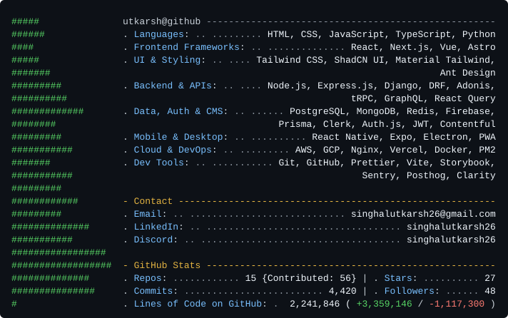
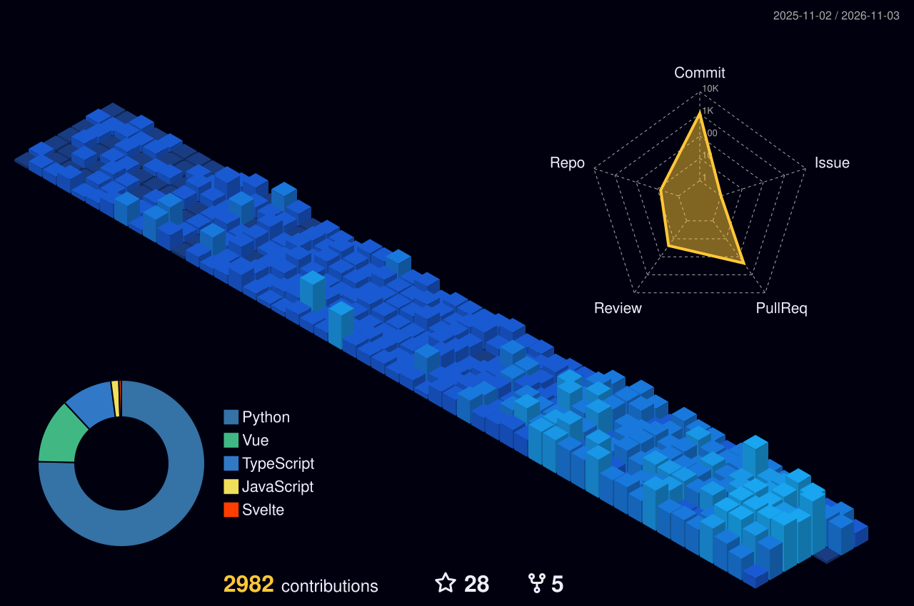

# Hi there! 👋 I'm Utkarsh Singhal

I'm a passionate **Software Developer** and **Full Stack Developer** from India. I specialize in building web and mobile applications, focusing on performance, scalability, and user experience.

 

Visit my portfolio website: [utkarsh-singhal.is-a.dev](https://utkarsh-singhal.is-a.dev/)



---


---

## 🛠 Open Source PRs

<!-- START_LATEST_PRS -->
- motdotla/dotenv#1070
- DavidHDev/vue-bits#183
<!-- END_LATEST_PRS -->

---

<!--START_SECTION:waka-->
```text
Total Time: 1,821 hrs 46 mins

TypeScript           842 hrs 0 mins         🟩🟩🟩🟩🟩🟩🟩🟩🟩🟩🟩⬜⬜⬜⬜⬜⬜⬜⬜⬜⬜⬜⬜⬜⬜   45.35 %
Python               480 hrs 17 mins        🟩🟩🟩🟩🟩🟩⬜⬜⬜⬜⬜⬜⬜⬜⬜⬜⬜⬜⬜⬜⬜⬜⬜⬜⬜   25.87 %
JSON                 69 hrs 57 mins         🟨⬜⬜⬜⬜⬜⬜⬜⬜⬜⬜⬜⬜⬜⬜⬜⬜⬜⬜⬜⬜⬜⬜⬜⬜   03.77 %
Markdown             67 hrs 36 mins         🟨⬜⬜⬜⬜⬜⬜⬜⬜⬜⬜⬜⬜⬜⬜⬜⬜⬜⬜⬜⬜⬜⬜⬜⬜   03.64 %
Vue.js               63 hrs 49 mins         🟨⬜⬜⬜⬜⬜⬜⬜⬜⬜⬜⬜⬜⬜⬜⬜⬜⬜⬜⬜⬜⬜⬜⬜⬜   03.44 %
```
<!--END_SECTION:waka-->


